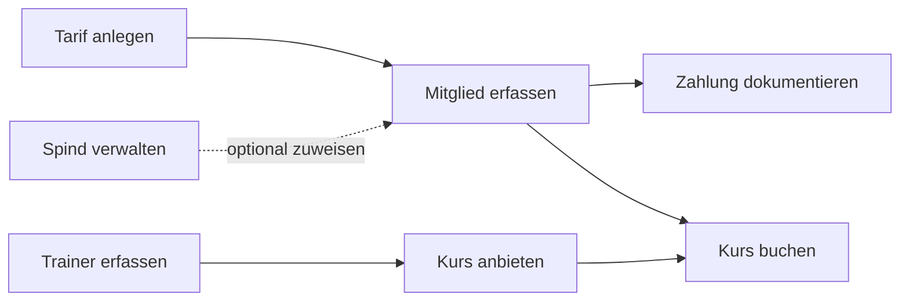

# Anforderungsdokument

## Fitnessstudio-Management-System

> **Version:** 0.1 (Entwurf)  
> **Stand:** 09.11.2026  
> **Projektart:** Datenbankprojekt mit geplanter Erweiterung zur Full-Stack-Webanwendung  
> **Technologien:** MySQL · Python (geplant) · HTML/CSS/JavaScript (geplant) · 3D-Webtechnologien (später)

> [!IMPORTANT]
> Dieses Dokument beschreibt **Anforderungen**, nicht bereits fertige Funktionen. Die mit **Phase 1** gekennzeichneten Anforderungen bilden den Umfang des aktuellen Datenbankprojekts. Website-, Login-, Online-Buchungs- und 3D-Funktionen gehören zu späteren Entwicklungsphasen.

---

## 1. Projektüberblick

### 1.1 Ausgangssituation

Ein Fitnessstudio muss Mitgliedschaften, Trainer, Spinde, Zahlungen und Kurse verwalten. Werden diese Informationen in getrennten Listen gespeichert, können doppelte Einträge, unklare Zuständigkeiten und fehlende Zusammenhänge entstehen.

### 1.2 Projektziel

Das Projekt soll ein übersichtliches, relationales Datenbanksystem zur Verwaltung eines Fitnessstudios bereitstellen. Mitglieder erhalten einen Tarif und können optional einem Trainer und einem Spind zugeordnet werden. Zahlungen werden dokumentiert. Kurse werden von Trainern geleitet; Mitglieder können Kurse buchen.

Die Datenbank wird später als Grundlage für eine moderne Webanwendung genutzt. Die Webanwendung soll langfristig auch eine interaktive 3D-Darstellung enthalten.

### 1.3 Erfolgskriterien

Das Projekt gilt in **Phase 1** als erfolgreich, wenn:

- das ER-Modell die vereinbarten Geschäftsregeln widerspiegelt;
- die sieben vorgesehenen Tabellen in MySQL erstellt werden können;
- Primärschlüssel, Fremdschlüssel und die erforderlichen Einschränkungen funktionieren;
- realistische, **fiktive** Testdaten eingefügt werden können;
- typische Abfragen mit `JOIN`, `GROUP BY` und weiteren SQL-Funktionen korrekte Ergebnisse liefern;
- der Entwurf verständlich dokumentiert und nachvollziehbar getestet ist.

---

## 2. Projektumfang und Entwicklungsphasen

| Phase | Schwerpunkt | Umfang | Status |
|---|---|---|---|
| **1 – Datenbank** | ER-Modell und MySQL | Tarife, Mitglieder, Trainer, Spinde, Zahlungen, Kurse, Kursbuchungen | **In Planung / Bearbeitung** |
| **2 – Webanwendung** | Backend, API, Frontend | Benutzeroberfläche, Dateneingabe, Verwaltung, Login und Rollen | Geplant |
| **3 – Erweiterungen** | Online-Service und 3D | Terminbezogene Reservierungen, interaktive 3D-Ansichten, weitere Funktionen | Zukunftsidee |

**Abgrenzung:** Die aktuelle Datenbank speichert eine Buchung für einen **Kurs** (z. B. „Yoga am Montag“), noch keine Buchung für einen einzelnen **Kurstermin an einem bestimmten Datum**. Für echte Einzeltermin-Reservierungen wäre später eine zusätzliche Entität wie `KURSTERMIN` sinnvoll.

---

## 3. Beteiligte und Nutzerrollen

| Rolle | Aufgabe | Phase |
|---|---|---|
| **Studioverwaltung** | Daten zu Mitgliedern, Tarifen, Trainern, Kursen, Spinden und Zahlungen verwalten | 1 (Daten und SQL), 2 (Oberfläche) |
| **Trainer** | Kurse leiten und gegebenenfalls Mitglieder betreuen | 1 (Zuordnung), 2 (eigener Zugang) |
| **Mitglied** | Einen Tarif besitzen und Kurse buchen | 1 (Datensätze), 2/3 (Selbstbedienung) |
| **Entwicklungsteam** | Datenmodell, SQL, Tests, Anwendung und Dokumentation pflegen | Alle |

> [!NOTE]
> „Rollen“ beschreiben hier zunächst fachliche Beteiligte. Eine technische Benutzer- und Rechteverwaltung ist **nicht** Teil des aktuellen Sieben-Tabellen-Modells.

---

## 4. Funktionale Anforderungen – Phase 1

**Prioritäten:** **Muss** = für die Datenbank erforderlich · **Soll** = wichtig, falls Zeit bleibt · **Später** = zukünftige Ausbaustufe.

### 4.1 Tarife

| ID | Anforderung | Priorität | Betroffene Tabelle |
|---|---|---|---|
| F-01 | Das System speichert Tarife mit Name, Monatsbeitrag und optionaler Beschreibung. | Muss | `TARIF` |
| F-02 | Jeder Tarif hat eine eindeutige Tarif-ID; sein Name darf nicht doppelt vorkommen. | Muss | `TARIF` |
| F-03 | Ein Tarif kann mehreren Mitgliedern zugeordnet werden. Jedes Mitglied gehört genau einem Tarif an. | Muss | `TARIF`, `MITGLIED` |

**Geschäftsentscheidung:** Die Tarife **Basic**, **Premium** und **VIP** können sich beim Preis und bei beschriebenen Leistungen unterscheiden. **Im aktuellen Modell dürfen alle Tarife alle Kurse buchen.** Eine Tabelle `TARIFKURS` wird deshalb nicht benötigt.

### 4.2 Mitglieder

| ID | Anforderung | Priorität | Betroffene Tabelle |
|---|---|---|---|
| F-04 | Für jedes Mitglied werden Vorname, Nachname und Eintrittsdatum gespeichert. | Muss | `MITGLIED` |
| F-05 | Jedes Mitglied besitzt eine eindeutige Mitglied-ID. | Muss | `MITGLIED` |
| F-06 | Jedes Mitglied muss einem vorhandenen Tarif zugeordnet sein. | Muss | `MITGLIED`, `TARIF` |
| F-07 | Ein Mitglied kann optional einen Trainer erhalten. | Muss | `MITGLIED`, `TRAINER` |
| F-08 | Ein Mitglied kann optional einen Spind erhalten. | Muss | `MITGLIED`, `SPIND` |

### 4.3 Trainer

| ID | Anforderung | Priorität | Betroffene Tabelle |
|---|---|---|---|
| F-09 | Trainer werden mit ID, Vorname, Nachname und Spezialisierung erfasst. | Muss | `TRAINER` |
| F-10 | Ein Trainer kann mehrere Mitglieder betreuen; ein Mitglied hat höchstens einen zugeordneten Trainer. | Muss | `TRAINER`, `MITGLIED` |
| F-11 | Ein Trainer kann mehrere Kurse leiten; jeder Kurs hat genau einen Trainer. | Muss | `TRAINER`, `KURS` |

### 4.4 Spinde

| ID | Anforderung | Priorität | Betroffene Tabelle |
|---|---|---|---|
| F-12 | Jeder Spind besitzt eine eindeutige ID und Spindnummer sowie einen Standort. | Muss | `SPIND` |
| F-13 | Ein Spind darf gleichzeitig höchstens einem Mitglied zugewiesen sein; ein Mitglied hat höchstens einen Spind. | Muss | `SPIND`, `MITGLIED` |
| F-14 | Mitglieder und Spinde dürfen auch ohne gegenseitige Zuordnung existieren. | Muss | `SPIND`, `MITGLIED` |

### 4.5 Zahlungen

| ID | Anforderung | Priorität | Betroffene Tabelle |
|---|---|---|---|
| F-15 | Das System dokumentiert Zahlungen mit Betrag, Datum, Methode und Verwendungszweck. | Muss | `ZAHLUNG` |
| F-16 | Jede Zahlung gehört genau zu einem vorhandenen Mitglied. Ein Mitglied kann mehrere Zahlungen besitzen. | Muss | `ZAHLUNG`, `MITGLIED` |
| F-17 | Die erfassten Zahlungen eines Mitglieds sollen per SQL auswertbar sein. | Soll | `ZAHLUNG`, `MITGLIED` |

**Wichtig:** Es geht um die **Dokumentation von Zahlungseinträgen**, nicht um die tatsächliche Übertragung von Geld. Eine Anbindung an Zahlungsdienste ist nicht vorgesehen.

### 4.6 Kurse

| ID | Anforderung | Priorität | Betroffene Tabelle |
|---|---|---|---|
| F-18 | Ein Kurs enthält Titel, Kategorie, Wochentag, Startzeit, Dauer, Raum und maximale Teilnehmerzahl. | Muss | `KURS` |
| F-19 | Jeder Kurs hat einen zugeordneten Trainer. | Muss | `KURS`, `TRAINER` |
| F-20 | Die maximale Teilnehmerzahl soll als positive ganze Zahl gespeichert werden. | Muss | `KURS` |

### 4.7 Kursbuchungen

| ID | Anforderung | Priorität | Betroffene Tabelle |
|---|---|---|---|
| F-21 | Ein Mitglied kann mehrere Kurse buchen; ein Kurs kann von mehreren Mitgliedern gebucht werden. | Muss | `KURSBUCHUNG` |
| F-22 | Jede Buchung verweist auf ein vorhandenes Mitglied und einen vorhandenen Kurs. | Muss | `KURSBUCHUNG` |
| F-23 | Buchungsdatum und Status (`gebucht` oder `storniert`) werden gespeichert. | Muss | `KURSBUCHUNG` |
| F-24 | Aktive Buchungen können über SQL angezeigt und gezählt werden. | Muss | `KURSBUCHUNG`, `KURS` |
| F-25 | Doppelte aktive Buchungen eines Mitglieds für denselben Kurs sollen verhindert werden. | Soll | `KURSBUCHUNG` |
| F-26 | Die Anzahl aktiver Buchungen soll die maximale Teilnehmerzahl nicht überschreiten. | Soll | `KURSBUCHUNG`, `KURS` |

**Technischer Hinweis:** F-25 und F-26 benötigen eine bewusste Implementierung, z. B. über Anwendungslogik, Transaktionen, Trigger oder zusätzliche Datenbankregeln. Ein normaler Fremdschlüssel überprüft diese beiden Regeln **nicht automatisch**.

---

## 5. Geschäftsregeln (Business Rules)

| Regel | Beschreibung | Umsetzung im Entwurf |
|---|---|---|
| G-01 | Ein Mitglied hat genau einen Tarif. | `MITGLIED.TarifID` als `NOT NULL` + Fremdschlüssel |
| G-02 | Ein Mitglied kann ohne persönlichen Trainer existieren. | `MITGLIED.TrainerID` darf `NULL` sein |
| G-03 | Ein Mitglied kann ohne Spind existieren. | `MITGLIED.SpindID` darf `NULL` sein |
| G-04 | Ein Spind wird höchstens einem Mitglied zugeordnet. | `MITGLIED.SpindID` ist `UNIQUE` (bei optionalem `NULL`) |
| G-05 | Jede Zahlung gehört zu genau einem Mitglied. | `ZAHLUNG.MitgliedID` als `NOT NULL` + Fremdschlüssel |
| G-06 | Jeder Kurs wird von genau einem Trainer geleitet. | `KURS.TrainerID` als `NOT NULL` + Fremdschlüssel |
| G-07 | Jede Kursbuchung verknüpft genau ein Mitglied mit genau einem Kurs. | Zwei `NOT NULL`-Fremdschlüssel in `KURSBUCHUNG` |
| G-08 | Alle Tarife können alle Kurse nutzen. | Keine Beziehung zwischen `TARIF` und `KURS` |
| G-09 | Stornierte Buchungen bleiben zunächst dokumentiert. | Status `storniert` statt sofortiger Löschung |

**Hinweis zu Kardinalitäten:** Ob eine Beziehung auf der „Viele“-Seite mindestens einen oder auch null Datensätze verlangt, muss im ER-Diagramm ausdrücklich modelliert werden. Eine gespeicherte Fremdschlüsselbeziehung allein erzwingt nicht, dass z. B. jeder Trainer bereits einen Kurs hat.

---

## 6. Datenmodell – vorgesehene Entitäten

Die Datenbank besteht in der ersten Phase aus **sieben Tabellen**:

| Entität | Aufgabe | Primärschlüssel | Wesentliche Fremdschlüssel |
|---|---|---|---|
| `TARIF` | Mitgliedschaftsangebote | `TarifID` | – |
| `MITGLIED` | Stammdaten der Mitglieder | `MitgliedID` | `TarifID`, `TrainerID`, `SpindID` |
| `TRAINER` | Trainerdaten | `TrainerID` | – |
| `SPIND` | Spinde und deren Standort | `SpindID` | – |
| `ZAHLUNG` | Zahlungseinträge | `ZahlungID` | `MitgliedID` |
| `KURS` | Kursangebote und Zeitplan | `KursID` | `TrainerID` |
| `KURSBUCHUNG` | Verbindung von Mitgliedern und Kursen | `BuchungID` | `MitgliedID`, `KursID` |

### 6.1 Beziehungsübersicht

| Beziehung | Typ | Fachliche Aussage |
|---|---|---|
| `TARIF` – `MITGLIED` | 1:n | Ein Tarif kann mehrere Mitglieder haben. |
| `TRAINER` – `MITGLIED` | 1:n, Zuordnung optional | Ein Trainer kann mehrere Mitglieder betreuen. |
| `SPIND` – `MITGLIED` | 1:1, Zuordnung optional | Eine Spindzuordnung ist auf beiden Seiten optional. |
| `MITGLIED` – `ZAHLUNG` | 1:n | Ein Mitglied kann mehrere Zahlungen haben. |
| `TRAINER` – `KURS` | 1:n | Ein Trainer kann mehrere Kurse leiten. |
| `MITGLIED` – `KURS` | m:n über `KURSBUCHUNG` | Mitglieder können mehrere Kurse buchen, Kurse haben mehrere Mitglieder. |

### 6.2 Vereinfachter Geschäftsablauf



Das ausführliche ER-Diagramm wird als eigene Grafik im Repository ergänzt, sobald die Beziehungen und Kardinalitäten abgestimmt sind.

---

## 7. Nichtfunktionale Anforderungen

| ID | Anforderung | Prüfkriterium | Phase |
|---|---|---|---|
| NF-01 | **Datenintegrität:** Referenzen dürfen nicht auf nicht vorhandene Datensätze zeigen. | Negativer Fremdschlüsseltest schlägt fehl. | 1 |
| NF-02 | **Eindeutigkeit:** IDs, Tarifnamen und Spindnummern sind eindeutig. | Doppelte Werte werden abgelehnt. | 1 |
| NF-03 | **Nachvollziehbarkeit:** SQL-Dateien lassen sich in dokumentierter Reihenfolge ausführen. | Neues Schema kann reproduziert werden. | 1 |
| NF-04 | **Wartbarkeit:** Einheitliche Namen und kommentierte SQL-Abfragen. | Struktur und Abfragen sind verständlich. | 1 |
| NF-05 | **Testbarkeit:** Fiktive Testdaten und dokumentierte Testfälle. | Testfälle lassen sich wiederholen. | 1 |
| NF-06 | **Datenschutz:** Keine realen Mitgliederdaten im öffentlichen GitHub-Repository. | Beispielwerte sind vollständig fiktiv. | Alle |
| NF-07 | **Sicherheit:** Zugriffe werden in der Webphase rollenbasiert begrenzt; Passwörter werden nicht im Klartext gespeichert. | Sicherheitstests der Webanwendung. | 2 |
| NF-08 | **Bedienbarkeit:** Die Weboberfläche ist auf Desktop und Smartphone nutzbar. | Grundfunktionen sind responsiv. | 2 |
| NF-09 | **Zugänglichkeit:** Zentrale Funktionen bleiben auch ohne 3D-Ansicht bedienbar. | 3D kann übersprungen werden. | 3 |
| NF-10 | **Leistung:** 3D-Elemente dürfen grundlegende Verwaltungsfunktionen nicht blockieren. | Kernfunktionen bleiben ohne 3D nutzbar. | 3 |

---

## 8. Typische Anwendungsfälle (Use Cases)

### UC-01 – Ein neues Mitglied anlegen

**Akteur:** Studioverwaltung  
**Voraussetzung:** Mindestens ein Tarif ist vorhanden.

1. Die Verwaltung erfasst Vorname, Nachname und Eintrittsdatum.
2. Ein vorhandener Tarif wird ausgewählt.
3. Optional werden Trainer und Spind zugeordnet.
4. Der Datensatz wird gespeichert.

**Ergebnis:** Das Mitglied besitzt eine eindeutige ID und einen gültigen Tarif. Ein nicht existierender Tarif wird abgelehnt.

### UC-02 – Einen Spind zuweisen

**Akteur:** Studioverwaltung  
**Voraussetzung:** Mitglied und Spind existieren.

1. Die Verwaltung wählt einen freien Spind.
2. Der Spind wird dem Mitglied zugeordnet.
3. Die Datenbank verhindert, dass ein zweites Mitglied denselben Spind erhält.

**Ergebnis:** Die Zuordnung ist eindeutig.

### UC-03 – Eine Zahlung dokumentieren

**Akteur:** Studioverwaltung  
**Voraussetzung:** Mitglied existiert.

1. Betrag, Datum, Methode und Verwendungszweck werden eingetragen.
2. Der Zahlungseintrag wird dem Mitglied zugeordnet.
3. Die Zahlung kann später über eine SQL-Abfrage angezeigt werden.

**Ergebnis:** Ein zugeordnetes Zahlungsprotokoll liegt vor; es wird **kein** echter Geldtransfer ausgeführt.

### UC-04 – Einen Kurs buchen

**Akteur:** Studioverwaltung (Phase 1), später Mitglied über die Webanwendung  
**Voraussetzung:** Mitglied und Kurs existieren.

1. Mitglied und Kurs werden ausgewählt.
2. Buchungsdatum und Status `gebucht` werden gespeichert.
3. Optional werden Doppelbuchung und Kapazität durch ergänzende Logik geprüft.
4. Bei Stornierung wird der Status auf `storniert` geändert.

**Ergebnis:** Die Kurszuordnung ist nachvollziehbar. Es handelt sich in Phase 1 um die Buchung eines **Kursangebots**, nicht um eine datumsgenaue Einzelstunde.

---

## 9. Akzeptanzkriterien und Testfälle – Phase 1

| Test-ID | Szenario | Erwartetes Ergebnis |
|---|---|---|
| AT-01 | Zwei Tarife mit demselben Namen speichern | Zweiter Eintrag wird abgelehnt. |
| AT-02 | Mitglied ohne Tarif speichern | Datensatz wird abgelehnt. |
| AT-03 | Mitglied mit existierendem Tarif speichern | Datensatz wird akzeptiert. |
| AT-04 | Mitglied ohne Trainer speichern | Datensatz wird akzeptiert. |
| AT-05 | Mitglied ohne Spind speichern | Datensatz wird akzeptiert. |
| AT-06 | Denselben Spind zwei Mitgliedern zuweisen | Zweite Zuordnung wird abgelehnt. |
| AT-07 | Zahlung für eine nicht vorhandene Mitglied-ID speichern | Datensatz wird abgelehnt. |
| AT-08 | Kurs ohne gültigen Trainer speichern | Datensatz wird abgelehnt. |
| AT-09 | Buchung mit ungültiger Mitglied- oder Kurs-ID speichern | Datensatz wird abgelehnt. |
| AT-10 | Mitglied, Tarif und optionalen Trainer per `JOIN` anzeigen | Zuordnungen werden korrekt ausgegeben. |
| AT-11 | Alle Zahlungen eines Mitglieds summieren | Die Abfrage liefert die richtige Summe. |
| AT-12 | Aktive Buchungen pro Kurs zählen | Nur Buchungen mit Status `gebucht` werden gezählt. |

**Erweiterte Tests (nach Umsetzung der Soll-Anforderungen):**

- AT-13: Eine doppelte aktive Buchung wird verhindert.
- AT-14: Eine zusätzliche Buchung bei voller Kurskapazität wird abgelehnt.
- AT-15: Ein stornierter Kursplatz wird bei der Kapazitätsprüfung wieder frei.

Die SQL-Tests sollen später in einer eigenen Datei dokumentiert werden.

---

## 10. Anforderungen an die spätere Webanwendung

Die folgenden Funktionen sind **nicht** Teil der ersten Datenbankabgabe. Sie zeigen den geplanten Portfolio-Ausbau.

| ID | Geplante Funktion | Mögliche technische Ergänzung |
|---|---|---|
| W-01 | Registrierung und Login für Mitglieder und Verwaltung | `BENUTZER`, Rollenmodell, sichere Passwort-Hashes |
| W-02 | Mitglieder über Formulare verwalten | Python-API und Webformulare |
| W-03 | Kursübersicht mit Filterung | API-Endpunkte und responsives Frontend |
| W-04 | Buchung und Stornierung im Browser | Buchungslogik und Transaktionen |
| W-05 | Echte Reservierungen für einzelne Kurstermine | Zusätzliche Entität `KURSTERMIN` |
| W-06 | Persönlicher Mitgliederbereich | Authentifizierung und Autorisierung |
| W-07 | Interaktive 3D-Ansicht des Studios | Modulare 3D-Komponente, z. B. WebGL-Technik |
| W-08 | 3D-Animationen beim Scrollen | Performance- und Accessibility-Tests |
| W-09 | Mehrsprachigkeit der Oberfläche | Textressourcen und Spracheinstellungen |

**Entwurfsgrundsatz:** Eine ansprechende 3D-Darstellung ergänzt die Funktionen; sie ersetzt weder Datenintegrität noch eine einfache Bedienung.

---

## 11. Offene Fragen und bewusste Entscheidungen

### Bereits festgelegt

- [x] Thema: Fitnessstudio-Verwaltung.
- [x] Sieben Kernentitäten für die erste Datenbankversion.
- [x] Alle Tarife haben Zugriff auf alle Kurse.
- [x] Kein zusätzliches `TARIFKURS` im ersten Modell.
- [x] Trainerzuordnung für Mitglieder ist optional.
- [x] Spindzuordnung ist optional und eindeutig.
- [x] Kursbuchungen werden über `KURSBUCHUNG` modelliert.

### Noch zu prüfen

- [ ] Sind die konkreten SQL-Datentypen und `NOT NULL`-Felder endgültig abgestimmt?
- [ ] Wie sollen Löschvorgänge bei referenzierten Datensätzen behandelt werden (`RESTRICT`, `SET NULL` etc.)?
- [ ] Wie wird die Doppelbuchungsregel (F-25) technisch umgesetzt?
- [ ] Wann soll die Kapazitätsregel (F-26) implementiert werden?
- [ ] Welche weiteren Daten benötigen Mitglieder in einer späteren Webversion (z. B. E-Mail)?
- [ ] Wann wird für Einzeltermine die zusätzliche Entität `KURSTERMIN` eingeführt?

---

## 12. Geplante Repository-Struktur

```text
fitnessstudio-management/
├── README.md
├── docs/
│   ├── ANFORDERUNGEN.md       # dieses Dokument
│   └── ER_MODELL.png          # später hinzufügen
├── sql/                       # später hinzufügen
│   ├── 01_schema.sql
│   ├── 02_testdaten.sql
│   └── 03_abfragen.sql
├── backend/                   # spätere Webphase
├── frontend/                  # spätere Webphase
└── tests/                     # später hinzufügen
```

Die aufgeführten zukünftigen Ordner und Dateien sind **Vorschläge** und noch keine abgeschlossenen Bestandteile.

---

## 13. Meilensteine und Definition of Done

| Meilenstein | Inhalt | Fertig, wenn … |
|---|---|---|
| M1 | Anforderungen und Geschäftsregeln | Anforderungen mit dem ER-Modell verglichen und offene Fragen dokumentiert sind. |
| M2 | ER-Modell | Entitäten, Attribute, Schlüssel, Optionalitäten und Kardinalitäten geprüft sind. |
| M3 | SQL-Schema | Alle sieben Tabellen mit Schlüsseln und Constraints erstellt werden können. |
| M4 | Beispieldaten | Fiktive, zusammenpassende Testdaten eingefügt sind. |
| M5 | SQL-Abfragen und Tests | Pflicht-Testfälle und Abfragen erfolgreich ausgeführt sind. |
| M6 | Dokumentation und GitHub | README, Anforderungen, ER-Grafik und SQL-Dateien nachvollziehbar veröffentlicht sind. |
| M7 | Webversion | Eine nutzbare Weboberfläche mit Backend und API existiert. |
| M8 | Portfolio-Ausbau | Erweiterte Reservierung und optionale 3D-Funktionen dokumentiert und getestet sind. |

### Definition of Done – erste Datenbankversion

- [ ] Anforderungsdokument geprüft.
- [ ] ER-Diagramm finalisiert.
- [ ] SQL-Schema erstellt.
- [ ] Primär- und Fremdschlüssel getestet.
- [ ] `UNIQUE`- und `NOT NULL`-Regeln getestet.
- [ ] Fiktive Beispieldaten eingefügt.
- [ ] Abfragen mit `JOIN` und Aggregatfunktionen ausgeführt.
- [ ] Testergebnisse dokumentiert.
- [ ] README und Projektdateien in GitHub verfügbar.

---

## 14. Änderungsprotokoll

| Version | Datum | Änderung |
|---|---|---|
| **0.1** | 09.11.2026 | Erster Entwurf mit Abgrenzung der Datenbankphase, Anforderungen, Geschäftsregeln, Testfällen und Web-Roadmap. |

> **Nächster Schritt:** Die Anforderungen mit dem vorhandenen ER-Diagramm vergleichen und nötige Korrekturen dokumentieren, **bevor** das SQL-Schema endgültig festgelegt wird.
